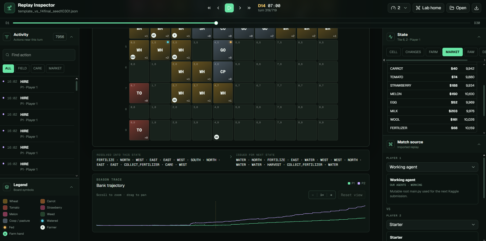
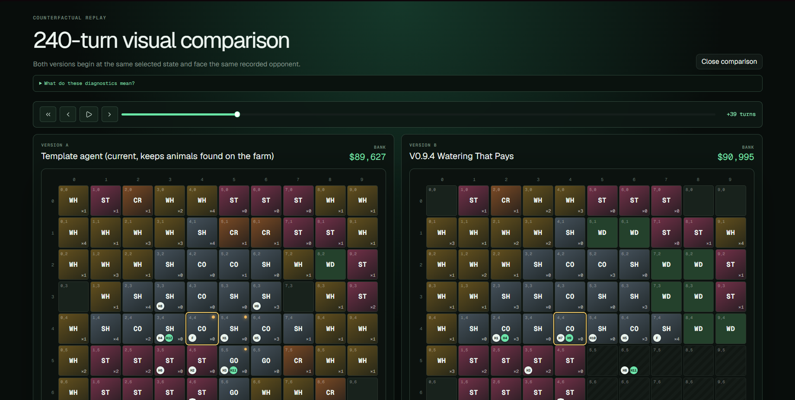
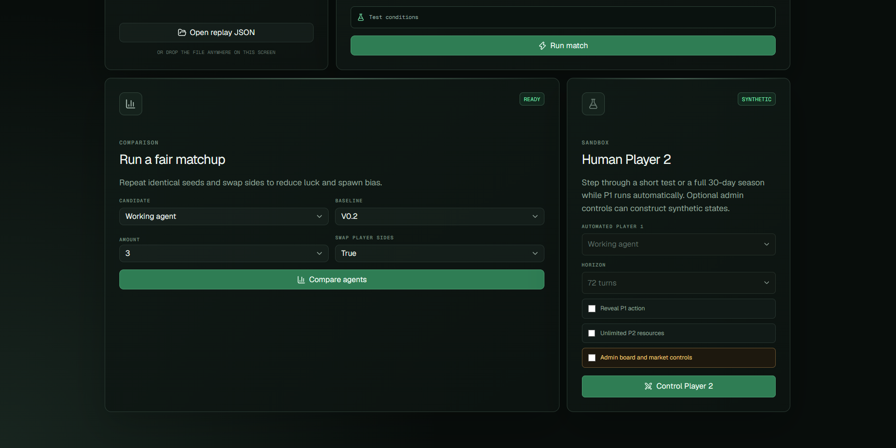

# Kaggriculture: a counter-focused agent, and what the leaderboard taught us

Our work on the Kaggle **Kaggriculture** simulation competition: the agent we submitted, our analysis of the
leaderboard and the top teams, and an unfinished second agent.

| Part | Status | Where |
|---|---|---|
| Final agent: F4 + counter + race + wheat round-trip + look-ahead 10 + snipe | **Finished, submitted** | [`agent/`](agent/) |
| Leaderboard and top-agent analysis | **Finished** | [`analysis/`](analysis/) |
| A new agent: our own planner, built from what the top teams do | **Unfinished.** We ran out of time. Work continues. | [`next-agent/`](next-agent/) |

Everything here is a dated lab record. Numbers come from local games against a fixed opponent panel, or from
replays of public ladder games. Where a result did not hold up on the live ladder, we say so below.

## At a glance

**The task.** Kaggriculture is a two-player farming simulation on Kaggle: plant, raise animals, sell into
markets both players share, and finish a 30-day season with more money than the opponent. Each entry is an
agent that plays every turn.

**What we found first.** A census of 139 mid-ladder replays from 137 teams showed that about **80% of the
ladder ran forks of one public scripted agent** (Metav4 and its successors), and none ran an exact public copy.
We also built a replay inspector to study games turn by turn (see [below](#the-replay-inspector)).

**Two lines of work followed.**

| Line | What it is | Headline result |
|---|---|---|
| Optimise the script | Small layers on the public F4 script that change how and when it sells | Our counter layer won **70 of 80** games against the unmodified script (70–4–6). The final agent was submitted. |
| Our own adaptive agent | An agent that decides from the game state each turn instead of replaying fixed moves | **0.892 of Metav4's final bank** on 24 paired seeds, reached on 10 October, after the deadline. Not submitted. |

**How it was judged.** Every change to the script was a paired test: the same seeds, played from both seats,
80 games, with a repeat on fresh seeds before a layer was kept. One change won **66–14** locally yet rated lower on the live ladder.
Details in [How we tested](#how-we-tested).

## The game

Two players farm for a 30-day season (720 steps, 24 per day) and sell into **shared markets**. Whoever holds more
money at the end wins. Selling fewer units of a product raises the opponent's price for it, so every decision
also changes the opponent's income. Engine: `kaggle-environments` 1.32.7.

## What the ladder looked like

We measured it from 139 mid-ladder replays (ranks ~50–500, 137 teams): about **80% of teams play one tape
family** (Metav4 and its successors). A "tape" is a fixed table of actions per step, optimised offline for the
whole season. Nobody runs a public file unchanged; most are forks that change a few steps. Details in
[`analysis/leaderboard/`](analysis/leaderboard/).

Against that field, a strong tape agent mostly loses or draws to near-copies of itself, and the games are
decided by tiny edits: who sells first at a lifted price.

## Our final agent

[`agent/main.py`](agent/main.py) is the public **F4** notebook agent plus five small layers. Most of the 1.2 MB is
inherited and machine-generated. Our changes are a few hundred lines. They are shown as diffs in
[`agent/lineage/`](agent/lineage/).

| # | Layer | Size | Credit |
|---|---|---|---|
| 1 | **Counter**: reorders our SELL orders against a detected mirror opponent | ~90 lines | ours |
| 2 | **Race**: lets the tape's early-sale rule fire at any price and on the next sale | 2 lines | ours |
| 3 | **Wheat round-trip**: sells bought wheat in the same turn at the lifted price | ~100 lines | ours, written with Codex |
| 4 | **Look-ahead 10**: advances sales that the tape would make in the next 10 turns, not 3 | 1 constant | ours |
| 5 | **Snipe**: two empty-order guards, a carrot margin, and a sale-snipe switch | 4 lines | **from a public notebook** (`a-song-of-ice-and-fire-fixed-flexible`, by AlekseiProvorov), not ours |

The base F4 agent, and everything it builds on, belongs to its public authors. See [`NOTICE`](NOTICE) and
[`agent/NOTICE.txt`](agent/NOTICE.txt).

### Local results

Each layer's paired result against the one before it is in [How we tested](#how-we-tested). Guards for the
final agent: 62–18 against F4 + counter, 70–10 against F1, 66–14 against F2, 67–13 against Metav4
([`evidence/final_snipe`](evidence/final_snipe/)).

One result went the other way: the public snipe notebook **beat look-ahead 10, 46–34** (seeds 8201–8240).
That is why the snipe lines are in the final agent.

## How we tested

Every change to the script was an A/B test against the version before it.

- **Paired seeds.** Both agents play the same 40 game seeds, so shops, weather and weeds are identical. The
  comparison is game by game, which removes much of the luck.
- **Both seats.** Each seed is played twice, once from each side of the board: 80 games per comparison.
- **Fresh-seed confirmation.** The method was to repeat a result on an unused seed range before keeping it.
  The table shows where that repeat is in the published evidence; for two layers it is not.
- **Our bank and the opponent's.** Markets are shared, so a change can win by lowering the opponent's income.
  We report both.
- **Keep rule.** Keep a layer if it beats its predecessor on the first seed set and repeats on fresh seeds,
  and check it against guard opponents (F1, F2, Metav4, the previous version). No p-values were computed;
  results are reported as wins–losses–ties.

Each layer against its baseline (W–L–T for the newer agent; every row is 80 games, 40 seeds, both seats):

| Layer | Baseline | Seeds | W–L–T | Confirmation on fresh seeds | Evidence |
|---|---|---|---|---|---|
| Counter on F4 | unmodified F4 | 6481–6520 | **70–4–6** | not in the published evidence | [`f4_screen/cF4_vs_F4.json`](evidence/f4_screen/cF4_vs_F4.json) |
| Race + wheat round-trip | F4 + counter | 6881–6920 | **66–14** | 69–5–6 (6961–7000); 62–16–2 (7001–7040) | [note](analysis/leaderboard/F4_RACE_2026-09-29.md), [`f4_race/`](evidence/f4_race/) |
| Look-ahead 10 | race + wheat | 7001–7040 | **58–18–4** | 66–12–2 (6921–6960) | [`f4_race/`](evidence/f4_race/) |
| Snipe (final) | look-ahead 10 | 8241–8280 | **60–18–2** | not in the published evidence | [`final_snipe/`](evidence/final_snipe/) |
| Final agent | the public snipe notebook | 8201–8240 | **77–3–0** | — | [`final_snipe/`](evidence/final_snipe/) |

The raw game file behind the 66–14 row is not published; the figure comes from the dated note linked in that
row. The two confirmations are published game files.

**Local wins did not guarantee ladder gains.** Race + wheat beat F4 + counter **66–14** locally, but on the
live ladder it was rated about **1,898 over 231 games**, below F4 + counter's **about 2,200 over
153 games**. These are two separate submissions rated against a changing field, so this is not a controlled
comparison. Our reading is that a fixed local panel did not represent a ladder of forks that each differ in
some way; we have not verified the cause.

The adaptive agent below was tested differently: 24 paired seeds from one seat against Metav4, reported as a
mean difference with its standard error, then repeated in four other setups (seats swapped, two other
opponents, fresh seeds).

## The replay inspector

A local web app for studying games turn by turn. It runs matches on the real game engine, opens recorded
replays, and lets us ask two agent versions what they would do from the same moment of a game.



**Replay view.** A turn scrubber over the 720 turns, the farm board of either player, the actions resolved
into this turn and issued for the next, market prices, and both players' bank over the season. We used it to
follow top teams' games step by step: where each worker went, when they sold, and when the bank moved.



**Counterfactual comparison.** Two versions of an agent start from the same selected state of a game and
play on against the same recorded opponent, side by side. We used it to see where a change altered decisions,
without the noise of a whole new game.



**Fair matchup.** Plays two agents on repeated identical seeds and swaps their sides, the same design as our
paired tests, at a small scale. A human-player sandbox sits beside it. (The screenshot shows the setup
form; we did not re-run this feature for this write-up.)

The census above was **not** done with the inspector: it used separate scripts that match each player's
moves against public agents, step by step. Those are described in
[`analysis/leaderboard/LEADERBOARD_CENSUS_2026-09-26.md`](analysis/leaderboard/LEADERBOARD_CENSUS_2026-09-26.md).

**The inspector's code is not in this repository.** It bundles third-party public agents for its matches and
would need those removed first. It was built with AI assistance (see Credits).

### What happened on the live ladder

- **F1 + counter** (96 games): 51–44–1, rating about 2,186, peak about 2,350.
- **F4 + counter** (153 games): 93–58–2, rating about 2,200. It went **5–18 against opponents rated 2,300+**.
  Most of those losses were to *close F4 forks*: they play F4 exactly, then sell a little earlier at one or two
  steps. Its rating stood at 2,093 when we deactivated it.
- **Race + wheat** (231 games): rating about **1,898**, below F4 + counter, even though it beat F4 + counter
  66–14 locally. Our local panel did not predict the ladder. We have no verified explanation.
- **Look-ahead 10**, submitted on the final day, is rated **1,872.3**. **Look-ahead 10 + snipe** (the final agent,
  submitted last) is rated **1,776.9**. Neither rating has settled yet, but the snipe version is the lower of the
  two even though it beat look-ahead 10 locally 60–18–2.
- The public notebook whose four lines we added was around 2,300 when we looked. Locally our final agent beats
  it 77–3.

Take-away: none of our three late agents rates above F4 + counter, even though each beat its predecessor locally.
Tuning a late layer on a fixed local panel did not transfer to a ladder of forks that each change something
different. We have not established why.

## What the top teams do

Full write-up: [`analysis/`](analysis/). The short version:

- **Their edge is units, not prices.** The top three produce about 52% more units per game than our planner
  (54% from more cells and animals, 46% from higher yield per cell). They sell those units at about the same
  prices.
- **Fertilizer is timed to the yield window.** Wheat at age 2, strawberries at ages 9 and 13. On days 12–27,
  78% of wheat bonus-window plant-days and 94% of strawberry production-window plant-days are watered *and*
  fertilized. Over 80% of their fertilizer applications use fertilizer the same worker just collected from an
  animal.
- **The plan is layered.** A scripted opener and land/hire schedule, a fixed layout template, and adaptive
  rules on top: shops tilt which crop or animal gets the next free cell, and carrot follows its price.
- **There are no discrete "shop modes".** Farms cluster by season phase. Conversion mostly happens at harvest
  (60–63% of plantings follow a harvest).
- **Routes repeat across games, not across days.** The same worker on the same day follows a recognisable
  route in different games. That is what an offline-optimised tape looks like.
- **A fourth top team plays differently**: heavy product trading, about 3,470 wheat units sold per game, for
  a similar final bank.

## The next agent

Our own planner reaches about **0.70 of Metav4's bank** in paired games. We ran about 22 single changes meant
to close the gap. One was a small gain still waiting for confirmation; the rest were neutral or negative.
Copying the top teams' routes, plan or job priorities onto our executor did not work either. The gap is
structural: the top agents' whole season is optimised as one piece, offline.

The plan is to do the same for our own farm: search for a whole-season plan automatically, with real games as
the judge, and keep the planner as the fallback when a game drifts from the plan. That is unfinished.

See [`next-agent/`](next-agent/).

## Our own adaptive agent

The **template agent** is our second attempt at an agent of our own. It does not replay fixed moves. Each
turn it reads the farm, the shops that are open and the market prices, decides what the farm should look like,
and assigns each worker its next job by scoring the jobs available in the current state.

Its layout targets are not our own design: they were learned from **169 public replays of one top team**.
What we added is the decision-making that carries them out, and a series of measured fixes to it.

| Agent | Share of Metav4's final bank | Games |
|---|---:|---|
| Our planner (first attempt, a separate agent) | 0.70 | 560 paired games |
| Template agent, first working version | 0.790 | 24 paired seeds, one seat |
| Template agent, current version | **0.892** | 24 paired seeds, one seat |
| Same version across five setups | 0.893 | 120 games: the 24 seeds plus seats swapped, two other opponents, fresh seeds |

The 0.70 and the 0.892 belong to **two different agents**; the template agent is not a continuation of the
planner. The target was at least 0.9, so it is not finished.

It reached 0.892 on **10 October 2026, after the competition's submission deadline**, and was **never
submitted** to the ladder, so it has no ladder rating. Its code is not published yet. The progress note, with
every version and what did and did not work:
[`next-agent/docs/TEMPLATE_PROGRESS_2026-10-11.md`](next-agent/docs/TEMPLATE_PROGRESS_2026-10-11.md).

## Repository map

```
agent/        final submission, licence, notices, diffs of every layer we added
analysis/     leaderboard census, ladder diagnosis, top-agent studies (dated lab notes)
evidence/     result files behind the analysis (per-game rows, summary tables, scripts)
tools/        game screen, replay fetcher, opponent classifier
next-agent/   unfinished planner, its experiment log and roadmap
```

## Reproducing

```bash
pip install kaggle-environments==1.32.7 requests
python tools/screen.py --candidate agent/main.py --opponent agent/main.py --seeds 8201-8202 --seats 2 --workers 2
```

Full instructions: [`tools/README.md`](tools/README.md). Games take about 10–30 seconds each. Use at most
2 workers on a laptop.

## What is not here

- **Raw replays.** They belong to Kaggle and its competitors. We publish derived tables, and the scripts to
  rebuild them from replays you fetch yourself.
- A few large derived tables (over 1 MB). They are listed in
  [`evidence/README.md`](evidence/README.md#files-not-included).
- Our earlier agents (v0.1–v0.10) and the replay inspector. They stay in our working repository.

## Team

Two people. **Eugenius Lesmana** (this repository's owner) made 214 of the 226 commits in our working
repository. He built the replay inspector, ran the ladder census and the top-team studies, designed the
counter and the sale-timing layers, set up the paired-testing method, and built the planner and the template
agent. The other team member contributed to the simulation lab, the tests and an early strategy branch.
Commit counts show who committed, not who wrote each line; see the AI-assistance note below.

## Credits and licence

- Licence: **Apache-2.0** ([`LICENSE`](LICENSE)).
- The agent in [`agent/`](agent/) derives from public Kaggle notebooks. Their authors are credited in
  [`NOTICE`](NOTICE) and [`agent/NOTICE.txt`](agent/NOTICE.txt), and every upstream notice stays inside
  `agent/main.py`.
- Kaggle and the `kaggle-environments` contributors wrote the engine.
- Much of the analysis and code was written with AI assistants (Claude and Codex), under the authors' direction.
- Top-ranked leaderboard teams are anonymised as **Team A–G**; the same letter is the same team in every note.
  Other ladder opponents are replaced by hashes in `evidence/census/`. Kaggle episode and submission IDs are kept
  as evidence references.
- The snipe changes come from the public notebook `a-song-of-ice-and-fire-fixed-flexible` by AlekseiProvorov.
